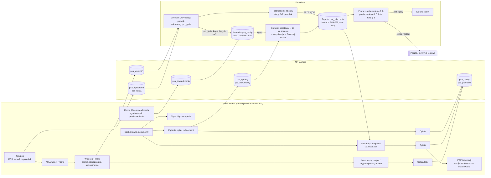

# Mapa procesów — stan z kodu (SESJA-PSA-ANALIZA-PRZEPLYWOW, Faza 1)

> Stan na 3.11.2026, gałąź po scaleniu R4 (`8a75c01`). Źródło: trasy `server/trasy/*.js`, widoki
> `publiczne/js/*.js`, katalog typów `server/logika/typy-zdarzen.js`. Pola wyliczone ekstraktorem
> (`<Pole etykieta=…>` w każdym komponencie) i sprawdzone ręcznie tam, gdzie heurystyka myli kontrolkę.
> Metryki z przeglądarki (kliknięcia, czasy, pola widoczne) są w `RAPORT-PRZEPLYWY.md` § 1 i w `testy/e2e/raport/wyniki.json`.

**Legenda źródła pola:** `reczne` — wpisuje człowiek; `kartoteka` — wybór osoby z kartoteki (`WyborZKartoteki`);
`rejestr` — wybór ze stanu rejestru (seria, akcjonariusz z akcjami, obciążenie); `auto` — wylicza system;
`domyslne` — system podstawia wartość, człowiek może zmienić.
**Podstawa:** przepis z `PRZEPISY-PSA.md` albo „operacyjna” albo **„brak”** (= kandydat do usunięcia, reguła 1).

---

## 1. Spis procesów

### Portal klienta (`publiczne/js/portal.js`, `wniosek.js`, `portal-start.js`; API `/api/psa/portal/*`)

| # | Proces | Ekrany / kroki | Endpointy | Tabele zapisywane | Zdarzenie w łańcuchu | Dokumenty | Powiadomienia | Opłata |
|---|---|---|---|---|---|---|---|---|
| P1 | Zgłoszenie nowej spółki („Zgłoś się”) | `#/zglos-sie` — 1 ekran (e-mail, KRS, nazwa) | `POST /portal/zgloszenia` | `psa_zgloszenia`, `psa_konta` (zaproszenie automatyczne, D-038) | — | — | e-mail z linkiem aktywacyjnym | — |
| P2 | Zaproszenie → aktywacja konta | `#/aktywuj/:token` (hasło ×2) → klauzula RODO | `GET/POST /portal/aktywacja/:token`, `POST /portal/rodo` | `psa_konta` | — | — | — | — |
| P3 | Wniosek o prowadzenie rejestru | `#/wniosek` — kreator 4 kroków: Spółka → Reprezentant → Akcjonariusze → Podsumowanie | `PUT /portal/wniosek`, `GET /wniosek/z-krs/:numer`, `POST/PUT/DELETE /wniosek/akcjonariusze`, `POST /wniosek/zloz` | `psa_wnioski`, `psa_wnioski_akcjonariusze` | — | — | e-mail do kancelarii (licznik) | — |
| P4 | Podpis kompletu i dowód | Start (baner kroku) → „Dokumenty”: pobranie, podpis (kwalifikowany / zaufany / osobisty / oryginał pocztą), skan dowodu reprezentanta | `GET /wniosek/dokumenty`, `POST /wniosek/dokumenty/:id/podpis`, `/oryginal-poczta`, `POST /wniosek/dowod`, `POST /wniosek/odeslij` | `psa_wnioski_dokumenty`, `psa_wnioski` | — | umowa o prowadzenie rejestru, uchwała, RODO, PEP (z `pakiet-wniosku.js`) | — | — |
| P5 | Opłata | Start / „Do zapłaty” → „Płatności” → atrapa tpay | `GET /portal/oplaty`, `POST /portal/oplaty/:id/zaplac`, ITN `POST /platnosci/tpay/itn` | `psa_oplaty`, `psa_platnosci` | — | faktura (poza systemem) | — | tak |
| P6 | Zgłoszenie przeniesienia rejestru od innego podmiotu | `#/zglos-sie` z „Kto dotąd prowadzi rejestr” ≠ „nikt” (warianty: dom maklerski / bank, notariusz, rada izby) → dalej jak P2–P4 + „Przeniesienie”: dokumenty startowe, pisma | `POST /portal/zgloszenia`, `GET /portal/przeniesienie`, `POST /portal/przeniesienie/dokumenty`, `GET /portal/przeniesienie/pisma/:kod` | `psa_zgloszenia`, `psa_przeniesienia` (przy przyjęciu wniosku), `psa_przeniesienia_dokumenty` | `przejecie` (dopiero K3) | wzór uchwały, klauzula, wypowiedzenie, potwierdzenie zawarcia, wezwanie do przekazania | — | — |
| P7 | Start / „Do zapłaty” | `#/` — karty: kroki wniosku, do zapłaty (ukryta, gdy pusta), spółki | `GET /portal/moje`, `GET /portal/oplaty`, `GET /portal/wnioski` | — | — | — | — | — |
| P8 | Zamówienie informacji z rejestru | „Spółka” → „Zamów informację z rejestru” → `#/informacja/:id` (Stan na dzień) → opłata → wydanie | `POST /portal/informacja/zamow`, `POST /portal/informacja/:oplataId/wydaj`, `GET /portal/informacja/:id` | `psa_oplaty`, `psa_wydane_dokumenty` | — | informacja z rejestru (art. 300(35) § 3; wersja akcjonariusza z maskowaniem) | — | tak |
| P9 | „Zgłoś błąd we wpisie” | „Spółka” → `#/zgloszenie-bledu/:id` (Czego dotyczy, opis) | `POST /portal/zgloszenie-nieprawidlowosci` | `psa_zgloszenia_nieprawidlowosci` | — | — | licznik w kancelarii | — |
| P10 | „Moje oświadczenia” | `#/konto` — 2 checkboxy (zgoda e-mail, powiadomienia automatyczne) + adres z kartoteki; cofnięcie z oknem „Cofnąć zgodę na e-mail?” | `GET/POST /portal/oswiadczenia` | `psa_oswiadczenia`, `psa_osoby` (D-092: kartoteka, nie rejestr) | — (D-092) | — | — | — |
| P11 | Żądanie wpisu z portalu („Zgłoszenie zmiany w rejestrze”) | `#/zgloszenie/:id` (Czego dotyczy, dokument, uwagi) → opłata → sprawa w kancelarii | `POST /portal/zadania`, `POST /portal/zadania/:id/dokumenty` | `psa_sprawy` (stan `nowa`, `zrodlo=portal`), `psa_dokumenty`, `psa_oplaty` | dopiero przy wpisie (K4) | — | — | tak (skuteczne z chwilą zapłaty) |
| P12 | Próba nowej spółki w tym samym logowaniu | „Wnioski” → nowy wniosek | `POST /portal/wniosek/nowy` → **403** (R4 P6) | — | — | — | — | — |

### Kancelaria (`publiczne/js/*.js`; API `/api/psa/*`)

| # | Proces | Ekrany / kroki | Endpointy | Tabele | Zdarzenie w łańcuchu | Dokumenty | Powiadomienia | Opłata |
|---|---|---|---|---|---|---|---|---|
| K1 | Zgłoszenia wstępne | `#/zgloszenia` → odrzuć / zaproś | `POST /zgloszenia/:id/zapros`, `/odrzuc` | `psa_zgloszenia`, `psa_konta` | — | — | e-mail z zaproszeniem | — |
| K2 | Obsługa wniosku z portalu | `#/wnioski/:id` — 4 zakładki: Dane spółki → Akcjonariusze (weryfikuj / do poprawy) → Dokumenty (wystaw, udostępnij, potwierdź podpis, podpis notariusza) → Decyzja (przyjmij / do uzupełnienia / odrzuć) | `/wnioski/:id/*` (20 tras) | `psa_wnioski*`, przy przyjęciu: `psa_spolki`, `psa_osoby`, `psa_konta`, `psa_spolki_dokumenty`, `psa_przeniesienia` | — | komplet wniosku | e-mail do klienta | — |
| K3a | Otwarcie rejestru — nowa spółka (kancelaria) | `#/spolki/nowa` — 4 kroki: Spółka → Umowa o prowadzenie rejestru → Pierwsza emisja i akcjonariat → Weryfikacja | `GET /spolki/z-krs/:numer`, `POST /spolki`, `POST /spolki/:id/otworz-rejestr` | `psa_spolki`, `psa_osoby`, `psa_emisje`, `psa_stan_akcji`, `psa_zdarzenia` | `emisja` + `objecie` (początek łańcucha) | zawiadomienie o wpisie | — | tak (wpis) |
| K3b | Otwarcie rejestru — spółka z przyjętego wniosku | kokpit → `#/spolki/:id/otworz` (ten sam kreator od kroku akcjonariatu, Z-005) | jw. | jw. | jw. | jw. | — | jw. |
| K3c | Przejęcie rejestru od innego podmiotu | `#/przeniesienia/:id` — jedna strona z 6 kartami (status + przejścia, Etap 3 checklista, Dokumenty, Etap 4 pisma, Etap 6 checklista, **Etap 7 protokół**), potem kokpit → „Otwórz rejestr — PRZEJĘCIE” (kreator stanu otwarcia) | `/przeniesienia/:id/*` (11 tras) | `psa_przeniesienia*`, `psa_spolki`, `psa_sprawy` | `przejecie` | protokół przejęcia (PDF + QES), pisma Etapu 4 | — | do decyzji (wytyczne 7.2 Etap 9) |
| K4 | **Wpis — kreator ogólny** (18 typów) | kokpit → `#/spolki/:id/zdarzenie` — „Co się stało” → „Podstawa” → **„Załóż sprawę i przejdź dalej”** → `#/sprawy/:id`: „Co się zmienia” → „Weryfikacja i podgląd” → „Dokonaj wpisu” | `POST /sprawy`, `PATCH /sprawy/:id {akcja: weryfikuj}`, `POST /sprawy/:id/podglad`, `POST /sprawy/:id/wpisz` | `psa_sprawy`, `psa_dokumenty`, `psa_zdarzenia`, tabele stanu | zdarzenie typu | zawiadomienie o wpisie (`zawiadomienie_wpis`), lista do KRS (§ 8) | uprzednie (§ 3) dla typów `pow`, o dokonanym wpisie (§ 7) | wg typu |
| K5 | **Wpis — zbycie akcji** (D-091) | `#/spolki/:id/zdarzenie?typ=przeniesienie` — „Co się zbywa” → „Podstawa” → „Sprawdzenie i wpis” (jeden ekran) | `POST /sprawy`, `PATCH`, `POST /sprawy/:id/powiadomienie`, `/zgoda`, `/wpisz` | jw. + `psa_listy` | `przeniesienie` | zawiadomienie, list z powiadomieniem | uprzednie (domyślnie, D-090) | tak |
| K6 | Sprawa z portalu (P11) | `#/sprawy/:id` stan `nowa` → **„Rozpocznij weryfikację”** → „Ustal podstawę wpisu” (okno) → kreator jak K4 kroki 3–4 | `PATCH /sprawy/:id {weryfikuj}`, `{podstawa}` | `psa_sprawy` | jw. | jw. | jw. | opłacona w portalu |
| K7 | Wstrzymanie / odmowa / anulowanie sprawy | `PasekAkcji` sprawy → okna z powodem | `PATCH /sprawy/:id {wstrzymaj|wznow|odmow|anuluj}` | `psa_sprawy` | — | pismo o odmowie (§ 7 zd. 2) | żądający | — |
| K8 | Sprostowanie zdarzenia | (a) kreator typ `sprostowanie`; (b) kokpit → historia → okno „Sprostuj” (`ModalSprostowania`); (c) okno „Sprostowanie emisji” | (a) jak K4; (b) `POST /zdarzenia/:id/sprostuj` | `psa_zdarzenia` | `sprostowanie` | zawiadomienie | § 3 | — |
| K9 | Przekazanie rejestru innemu podmiotowi | kokpit → okno `ModalPrzekazania` | `POST /spolki/:id/przekazanie` | `psa_spolki`, `psa_przeniesienia_archiwum` | `przekazanie_rejestru` | eksport ZIP | — | — |
| K10 | Zmiana danych spółki | kokpit → „Dane rejestrowe” | `PUT /spolki/:id` | `psa_spolki`, `psa_zdarzenia` | `zmiana_danych_spolki` | — | — | — |
| K11 | Powiadomienia, zawiadomienia, kolejka listów | sprawa → „Uprzednie powiadomienie”; `#/zawiadomienia`; `#/listy` (nadanie: data, numer, skan; „Usuń z wysyłki”) | `/zawiadomienia/wyslij`, `/listy/:id/nadanie`, `/listy/:id/usun-z-wysylki` | `psa_listy`, `psa_wydane_dokumenty`, `psa_sprawy` (blokada wpisu) | — | pisma | e-mail albo list | — |
| K12 | Informacja z rejestru (kancelaria, dla organu) | kokpit → „Informacja z rejestru” (`#/spolki/:id/wydruk`); `#/informacje` (dziennik, dla organu: Spółka, Organ, Sygnatura) | `GET /spolki/:id/informacja.html`, `POST /informacje/organ` | `psa_wydane_dokumenty` | — | informacja (art. 300(35) § 3) | — | — |
| K13 | Kartoteka — nowa osoba, edycja, AML | `#/osoby` → okno `FormularzOsoby`; `#/osoby/:id` (identyfikacja, adresy, kontakt i oświadczenia, AML, akcje, sprawy); w kreatorach „+ Nowa osoba w kartotece”; w zbyciu osobny `NowyNabywca` | `POST /osoby`, `PUT /osoby/:id`, `POST /osoby/:id/aml-skany`, `/zapros-do-portalu` | `psa_osoby`, `psa_oswiadczenia`, `psa_osoby_skany_aml` | — (D-092) | — | zaproszenie do portalu | — |
| K14 | Opłaty | `#/oplaty` — lista, okno „Nowa opłata”, faktura, przypomnienia, odnowienia | `/oplaty/*` (9 tras) | `psa_oplaty` | — | — | przypomnienie e-mail | — |
| K15 | Zgłoszenia błędów z portalu | kokpit → okno „Kwalifikacja zgłoszenia” | `POST /zgloszenia-nieprawidlowosci/:id/kwalifikuj` | `psa_zgloszenia_nieprawidlowosci` | — | — | — | — |

---

## 2. Typy wpisu w kodzie (wyliczone z `TYPY`, nie z pamięci)

22 typy; 19 w kreatorze (`dostepneWKreatorze()`, `SPRINT_KREATORA = 6`), 3 na osobnych ekranach
(`zmiana_danych_spolki` K10, `przekazanie_rejestru` K9, `przejecie` K3c).
Portal oferuje typy ze sprintów 1–2 bez `z_urzedu` (`portal.js:1929`).

| Typ (kod) | Nazwa | W kreatorze | Odpł. | Powiad. art. 300(34) § 3 | Z urzędu | Checklista (wym./opc.) | Dokumenty | Podstawa (z kodu) |
|---|---|---|---|---|---|---|---|---|
| `emisja` | Emisja akcji | tak | tak | — | — | 3/1 | zawiadomienie_wpis | art. 300(33) § 1 KSH |
| `objecie` | Objęcie akcji | tak | tak | — | — | 4/2 | zawiadomienie_wpis | art. 300(33) § 1 KSH |
| `przeniesienie` | Przeniesienie akcji | tak (K5) | tak | tak | — | 5/1 | zawiadomienie_wpis | art. 300(34) § 3 KSH |
| `umorzenie` | Umorzenie akcji | tak | tak | tak | — | 4/2 | zawiadomienie_wpis | art. 300(34) § 3 KSH |
| `zobowiazanie` | Zobowiązanie do przeniesienia lub obciążenia akcji | tak | tak | tak | — | 2/1 | zawiadomienie_wpis | art. 300(34) § 4 KSH |
| `obciazenie` | Ustanowienie zastawu lub użytkowania | tak | tak | tak | — | 2/1 | zawiadomienie_wpis | art. 300(34) § 3 KSH |
| `wykreslenie_obciazenia` | Wykreślenie obciążenia | tak | tak | — | — | 2/1 | zawiadomienie_wpis | art. 300(33) § 1 KSH |
| `prawo_glosu_zastawnika` | Prawo głosu zastawnika lub użytkownika | tak | tak | tak | — | 2/1 | zawiadomienie_wpis | art. 300(33) § 1 KSH |
| `zajecie` | Zajęcie akcji przez organ egzekucyjny | tak | — | — | tak | 2/0 | — | art. 300(34) § 2 KSH |
| `wykreslenie_zajecia` | Uchylenie zajęcia | tak | — | — | tak | 1/0 | — | art. 300(34) § 2 KSH |
| `zmiana_danych_akcjonariusza` | Zmiana danych akcjonariusza | tak | — | — | — | 1/0 | zawiadomienie_wpis | art. 300(33) § 1 KSH |
| `zmiana_danych_spolki` | Zmiana danych spółki | nie (K10) | — | — | — | 1/0 | — | art. 300(33) § 1 KSH |
| `przekazanie_rejestru` | Przekazanie rejestru | nie (K9) | — | — | — | 0/0 | — | art. 300(33) § 1 KSH |
| `przejecie` | Przejęcie rejestru (otwarcie) | nie (K3c) | — | — | — | 0/0 | — | art. 300(31) § 1 KSH |
| `uprawnienie` | Uprawnienie, przywilej albo obowiązek | tak | — | — | — | 2/1 | zawiadomienie_wpis | art. 300(33) § 1 KSH |
| `ograniczenie` | Ograniczenie w rozporządzaniu akcją | tak | tak | — | — | 2/1 | zawiadomienie_wpis | art. 300(34) § 6 KSH |
| `zdarzenie_inne` | Inne zdarzenie | tak | — | — | — | 1/0 | — | art. 300(33) § 1 KSH |
| `sprostowanie` | Sprostowanie wcześniejszego zdarzenia | tak (+ K8 b, c) | — | tak | — | 1/0 | zawiadomienie_wpis | art. 300(34) § 1 KSH |
| `uniewaznienie` | Unieważnienie akcji orzeczeniem sądu | tak | tak | — | — | 4/1 | zawiadomienie_wpis | art. 300(51) KSH |
| `przeniesienie_ulamka` | Przeniesienie ułamkowej części akcji | tak | tak | tak | — | 4/2 | zawiadomienie_wpis | art. 300(2) § 3 oraz art. 300(43) KSH |
| `przedstawiciel` | Wspólny przedstawiciel współuprawnionych | tak | — | — | — | 1/0 | zawiadomienie_wpis | art. 300(38) § 3-4 KSH |
| `pokrycie_akcji` | Wzmianka o pokryciu akcji | tak | — | — | — | 1/0 | zawiadomienie_wpis | art. 300(33) § 1 pkt 9 KSH |

### 2.1 Kroki wpisu dziś (K4 — kreator ogólny)

| Krok | Ekran | Pole | Źródło | Wym. | Podstawa |
|---|---|---|---|---|---|
| 1 „Co się stało” | `#/spolki/:id/zdarzenie` | Typ zdarzenia (kafelki, 7 grup) | reczne (albo z adresu `?typ=`) | tak | art. 300(33) § 1 |
| 2 „Podstawa” | jw. | Data wpływu | domyslne (dziś) | tak | art. 300(34) § 1 (bieg 7 dni) |
| 2 | jw. | Żądający wpisu | kartoteka | tak (poza z urzędu) | art. 300(34) § 1 |
| 2 | jw. | W jakim charakterze | reczne (lista) | tak | art. 300(34) § 1 |
| 2 | jw. | Interes prawny żądającego | reczne | tak, gdy „inna osoba” | art. 300(34) § 1 |
| 2 | jw. | Rodzaj dokumentu stanowiącego podstawę | reczne (lista) | nie | art. 300(34) § 4 |
| 2 | jw. | Data dokumentu | reczne | gdy rodzaj | art. 300(34) § 4 |
| 2 | jw. | Opis podstawy (opcjonalnie) | reczne | nie | operacyjna (notatka) |
| 2 | jw. | Dokumenty (opcjonalnie): typ + plik | reczne | nie | art. 300(34) § 4 |
| — | **przycisk „Załóż sprawę i przejdź dalej”** → `PATCH weryfikuj` (automatycznie) → nowy adres `#/sprawy/:id` | | | | |
| 3 „Co się zmienia” | `#/sprawy/:id` (`KreatorSprawy`) | pola typu — § 2.2 | | | |
| 4 „Weryfikacja i podgląd” | jw. | checklista (2–6 pozycji), „Notatka o uzasadnionych wątpliwościach” (gdy zaznaczone), „Osoba działająca przy wpisie” (lista), „Przelicz podgląd” | reczne / domyslne | wg typu | art. 300(34) § 5 / operacyjna |
| — | **„Dokonaj wpisu”** | | | | |

### 2.2 Pola kroku „Co się zmienia” wg typu (ekstraktor `<Pole>` w `kreator.js`)

| Typ | Pola (źródło, * = wymagane) |
|---|---|
| `emisja` | Oznaczenie serii* (reczne); Liczba akcji* (reczne); Numer pierwszej akcji (auto, nadpisywalne); Cena emisyjna (reczne); Rodzaj akcji (domyslne „zwykła”); Data wpisu emisji do KRS* (reczne); Data emisji (reczne); Tytuł emisji (domyslne „Emisja założycielska”); Podstawa prawna emisji (reczne); Obowiązki wobec spółki (reczne); Opis (reczne) — **11 pól** |
| `objecie` | na pozycję: Obejmujący* (kartoteka); Liczba akcji* (reczne); Numery akcji — ścieżka wyjątkowa (auto); Seria* (rejestr) |
| `przeniesienie` (ścieżka „z podstawy”) | Zbywca* (rejestr); Tytuł przejścia (domyslne); pozycje jak `objecie` |
| `umorzenie` | Tryb umorzenia (reczne); Akcjonariusz* (rejestr, `<select>`); Liczba akcji*; Numery akcji (opcjonalnie) |
| `uniewaznienie` | Sąd; Sygnatura akt; Data orzeczenia; Akcjonariusz* (rejestr, `<select>`); Liczba akcji* |
| `obciazenie` | Rodzaj obciążenia; Akcjonariusz, którego akcje są obciążane* (**kartoteka** — nie rejestr); Zastawnik / użytkownik* (kartoteka); Liczba akcji*; Numery akcji; Opis |
| `wykreslenie_obciazenia` | Obciążenie* (rejestr) |
| `prawo_glosu_zastawnika` | Obciążenie* (rejestr); Prawo głosu (reczne) |
| `zajecie` | Organ egzekucyjny (kartoteka); Akcjonariusz (dłużnik) (kartoteka); Liczba akcji objętych zajęciem* lub Numery zajmowanych akcji*; Opis |
| `wykreslenie_zajecia` | Zajęcie* (rejestr) |
| `uprawnienie` | (wykreślenie) Wykreślane uprawnienie*; (ustanowienie) Rodzaj; Zakres; Akcjonariusz* (kartoteka); Tytuł; Treść |
| `ograniczenie` | (wykreślenie) Wykreślane ograniczenie*; Zakres; Numery akcji*; Opis |
| `zmiana_danych_akcjonariusza` | Akcjonariusz* (kartoteka); pola zmieniane (reczne, wg wyboru) |
| `zobowiazanie` | Akcjonariusz składający oświadczenie* (kartoteka); Rodzaj zobowiązania; Seria (opcjonalnie, rejestr); Treść oświadczenia |
| `zdarzenie_inne` | Opis zdarzenia* |
| `przeniesienie_ulamka` | Zbywca* (rejestr); Numer akcji*; Ułamek zbywanej części*; Tytuł przejścia (domyslne); Nabywca* (kartoteka) |
| `przedstawiciel` | Numer akcji*; Wspólny przedstawiciel (kartoteka) |
| `pokrycie_akcji` | Akcjonariusz* (kartoteka); Wzmianka o pokryciu* (reczne) |
| `sprostowanie` | prostowane zdarzenie (rejestr); uzasadnienie (reczne) |

### 2.3 K5 — zbycie (R4, `definicjaWpisu.przeniesienie`) — wzorzec docelowy

| Krok | Pole | Źródło | Wym. | Widoczne gdy | Podstawa |
|---|---|---|---|---|---|
| 1 Co się zbywa | Zbywca | rejestr | tak | zawsze | art. 300(33) § 1 pkt 6 |
| 1 | Liczba zbywanych akcji | reczne | tak | zawsze | art. 300(33) § 1 pkt 6 |
| 1 | Seria / Numery akcji | auto (dobór), ręcznie za przyciskiem | — | zawsze (podgląd) | art. 300(33) § 1 pkt 6 |
| 1 | Nabywca | kartoteka (+ `NowyNabywca`) | tak | zawsze | art. 300(33) § 1 pkt 6 |
| 2 Podstawa | Data umowy zbycia | reczne | tak | zawsze | art. 300(34) § 4 |
| 2 | Umowa (plik) | reczne | nie | zawsze | art. 300(34) § 4 |
| 2 | Kto żąda wpisu | domyslne (nabywca) | tak | zawsze | art. 300(34) § 1 |
| 2 | Tytuł przejścia akcji | domyslne (sprzedaż) | tak | zawsze | art. 300(33) § 1 pkt 6 |
| 2 | Data wpływu, rodzaj dokumentu | auto | tak | nigdy | art. 300(34) § 1, § 4 |
| 3 Sprawdzenie i wpis | Zgoda spółki | reczne | — | ograniczenie z wymogiem zgody | art. 300(34) § 6 |
| 3 | Zgoda spółki (akcje niepokryte) | reczne | — | dobór zawiera niepokryte | art. 300(40) § 1 |
| 3 | Prawo pierwszeństwa wyczerpane | reczne | — | ograniczenie z prawem pierwszeństwa | art. 300(42) |
| 3 | Uprzednie powiadomienie (domyślne) albo zgoda (jedno pole) | domyslne | — | zawsze | art. 300(34) § 3 |
| 3 | Checklista weryfikacji (6) | reczne (człowiek) | wym. | zawsze | art. 300(34) § 5 (D-052) |
| 3 | Osoba działająca | auto (notariusz z ustawień) | — | nigdy | operacyjna |

---

## 3. Pozostałe procesy — pola

| Proces | Krok / ekran | Pole | Źródło | Wym. | Podstawa |
|---|---|---|---|---|---|
| P1 | `#/zglos-sie` | E-mail | reczne | tak | operacyjna (konto, art. 300(34) § 9) |
| P1 | jw. | Numer KRS spółki | reczne (→ nazwa z KRS) | tak | art. 300(33) § 1 pkt 2 |
| P1 | jw. | Nazwa spółki | auto (KRS), nadpisywalne | nie | art. 300(33) § 1 pkt 1 |
| P1/P6 | jw. | Kto dotąd prowadzi rejestr | reczne (lista) | tak | wytyczne 7.2 Etap 1 |
| P6 | jw. | Nazwa dotychczasowego podmiotu | reczne | nie | wytyczne 7.2 Etap 1 |
| P6 | jw. | Okres wypowiedzenia (jeśli znany) | reczne | nie | wytyczne 7.2 Etap 1 — „informacyjnie” |
| P3 Spółka | `#/wniosek` 1/4 | KRS, Firma*, NIP, REGON, adres (5), sąd, wydział, organ, data rejestracji, kapitał, data umowy, e-mail, telefon, ADE | auto z KRS (`/wniosek/z-krs`) + reczne | wg pola | art. 300(33) § 1 pkt 1–3; NIP/REGON/telefon/kapitał — operacyjna |
| P3 Reprezentant | 2/4 | Imię i nazwisko, Funkcja, Sposób reprezentacji, PESEL, Imiona rodziców, e-mail, dowód (rodzaj, numer), adres, skan dowodu | reczne | wg pola | AML (art. 37 u. AML — 🔵) / operacyjna |
| P3 Akcjonariusze | 3/4 | `FormularzOsoby` na osobę (+ liczba akcji, seria) | reczne | tak | art. 300(33) § 1 pkt 4–5 |
| K3a Spółka | `#/spolki/nowa` 1/4 | **te same pola co P3 1/4 i 2/4** (KRS, odpowiedź KRS, skład organu ×2, firma, organ, NIP, REGON, adres 6, sąd, wydział, telefon, e-mail, ADE, data rejestracji, kapitał, data umowy) | auto z KRS + reczne | wg pola | jw. |
| K3a Umowa | 2/4 | Data uchwały o wyborze; Data umowy o prowadzenie rejestru; Data otwarcia rejestru; Sposób zawarcia umowy*; Skan umowy | reczne | wg pola | art. 300(31) § 5, art. 300(32) |
| K3a Emisja | 3/4 | `KrokEmisja` (11 pól) + `PozycjaZalozycielska` na akcjonariusza (Obejmujący*, Liczba*, Wzmianka o pokryciu, Cena, Rodzaj świadczenia, Czas świadczenia, Uprawnienia szczególne) | reczne / kartoteka | wg pola | art. 300(33) § 1 pkt 3–4, 9, 11 |
| K3c Przejęcie | `#/przeniesienia/:id` | Data zawarcia umowy (natywne `type=date`); Data rozwiązania (natywne `type=date`); Opis rozbieżności; checklista weryfikacji (5); dokumenty (typ z 8 + źródło + plik); checklista odbioru (6); **protokół: pobierz PDF → podpisz poza systemem → wgraj** | reczne | wg etapu | wytyczne § 7 |
| K11 nadanie | `#/listy` | Data nadania (natywne `type=date`); Numer nadania*; Skan potwierdzenia | reczne | tak | art. 300(34) § 3 (dowód powiadomienia) |
| P8 | `#/informacja/:id` | Stan na dzień | domyslne (dziś), `PoleDaty` | tak | art. 300(35) § 3 |
| P9 | `#/zgloszenie-bledu/:id` | Czego dotyczy*; Opis* | reczne | tak | operacyjna |
| P11 | `#/zgloszenie/:id` | Czego dotyczy*; Dokument (plik); Uwagi | reczne | tak / nie / nie | art. 300(34) § 1, § 4 |
| K14 | okno „Nowa opłata” | Spółka*, Rodzaj*, Rok*, Kwota, Notatka | reczne | wg pola | operacyjna (§ 15b taksy) |

---

## 4. Rozbieżne wzorce (ta sama czynność — różne komponenty / liczba kroków)

| # | Czynność | Warianty w kodzie | Miejsca |
|---|---|---|---|
| W1 | **Wybór akcjonariusza** | (a) `WyborZKartoteki` (wyszukiwarka całej kartoteki) — `obciazenie`, `uprawnienie`, `zobowiazanie`, `pokrycie_akcji`, `zmiana_danych_akcjonariusza`, `zajecie`; (b) `<select>` akcjonariuszy z akcjami (rejestr) — `umorzenie`, `uniewaznienie`, zbywca w `przeniesienie`, `przeniesienie_ulamka` | `kreator.js:574, 692, 762, 921, 1007, 1034, 1215` vs `wpis-zbycia.js` |
| W2 | **Nowa osoba w trakcie wpisu** | (a) „+ Nowa osoba w kartotece” w `WyborZKartoteki` → `FormularzOsoby`; (b) osobny `NowyNabywca` (10 pól, inny układ) w zbyciu | `ui-rejestr.js:1308`, `wpis-zbycia.js:238` |
| W3 | **Pole daty** | `PoleDaty` (37 użyć) vs natywne `<input type="date">` | `listy.js:65` (Data nadania), `przeniesienia.js:107, 110`, `wnioski.js:1156` (Data otrzymania oryginału) |
| W4 | **Okno potwierdzenia** | `Modal` (37 użyć) vs `window.confirm` (9) vs `alert` (5) | confirm: `kreator.js:1398, 1655`, `osoby.js:187`, `rdzen.js:225`, `wniosek.js:84, 411`, `wnioski.js:484, 1383, 1542`; alert: `kokpit.js`, `sprawy.js`, `wnioski.js`, `zgloszenia.js` ×2 |
| W5 | **Pasek akcji** | `PasekAkcji` tylko w `sprawy.js` (2) i `wpis-zbycia.js` (5); gdzie indziej ręczne `<button>` w stopkach kart i `NawigacjaKreatora` | `wniosek.js`, `wnioski.js`, `przeniesienia.js`, `kokpit.js` |
| W6 | **Kreator wpisu** | (a) 4 kroki na **dwóch adresach** z przyciskiem „Załóż sprawę i przejdź dalej” w środku (K4); (b) 3 kroki na jednym ekranie (K5) | `kreator.js:17`, `sprawy.js:734` vs `wpis-zbycia-logika.js:105` |
| W7 | **Nazwa kroku weryfikacji** | „Weryfikacja i podgląd” (K4) vs „Sprawdzenie i wpis” (K5) vs „Weryfikacja” (K3a) | jw., `spolki.js:67` |
| W8 | **Podstawa wpisu** | krok 2 kreatora (K4) vs okno „Ustal podstawę wpisu” / „Popraw podstawę wpisu” (`PodstawaWpisu`, sprawa z portalu K6) vs krok 2 zbycia (K5) — trzy różne zestawy pól | `kreator.js:1532`, `sprawy.js:960`, `wpis-zbycia.js:244` |
| W9 | **Sprostowanie** | typ w kreatorze vs okno w historii kokpitu vs okno sprostowania emisji | K8 |
| W10 | **Dane spółki** | wpisywane w portalu (P3 1/4) i osobno w kancelarii (K3a 1/4) — ten sam zestaw pól w dwóch formularzach o innym układzie | `wniosek.js`, `spolki.js` |
| W11 | **Lista danych (podgląd)** | `ListaDanych` (8 użyć: kartoteka, portal) vs `Metryka` (33) vs `Para` (8) vs tabele ad hoc | `ui-rejestr.js` |
| W12 | **Znacznik kontaktu** | `ZnacznikKontaktu` w 7 plikach; brak w kokpicie przy liście akcjonariuszy i w „Akcjonariusze” wniosku | — |

---

## 5. Przeniesienie rejestru — „protokół”

**Wystąpienia w kodzie i UI** (`grep -i protok`):

| Miejsce | Co to jest |
|---|---|
| `server/przeniesienia.js:251` `protokol()` | PDF „Protokół przejęcia rejestru akcjonariuszy”: dane spółki, dotychczasowy podmiot, daty umowy, **lista dokumentów z SHA-256**, **odhaczona checklista odbioru (Etap 6)**, zdanie o odwzorowaniu, miejsce na podpis kwalifikowany |
| `server/przeniesienia.js:283` `zatwierdz()` | przyjmuje plik podpisany przez notariusza; test podpisu + porównanie z protokołem (D-086); ustawia `zatwierdzono` |
| `server/logika/przeniesienie.js:157` | przejście „Uzgodnienie → Aktywny” blokowane: „Brak zatwierdzenia przez notariusza podpisem kwalifikowanym (protokół przejęcia)” |
| `server/trasy/przeniesienia.js:105, 113` | `GET /:id/protokol.pdf`, `POST /:id/zatwierdzenie` |
| `publiczne/js/przeniesienia.js:157–165` | karta „Etap 7 — protokół przejęcia i zatwierdzenie (podpis kwalifikowany notariusza)”: „Pobierz protokół przejęcia (PDF)”, plik, „Wgraj protokół podpisany przez notariusza” |
| migracje (`psa_przeniesienia.protokol_*`, `zatwierdzenie_*`) | 7 kolumn |

**Podstawa:** w `PRZEPISY-PSA.md` brak przepisu o protokole odbioru/uzgodnienia. Wytyczne § 7.2 Etap 7
mówią o „zatwierdzeniu przez notariusza (QES)” zdarzenia otwierającego PRZEJĘCIE; dokumentem wymaganym
ustawowo jest **uchwała akcjonariuszy o wyborze podmiotu** (art. 300(31) § 5) — dziś jeden z 8 typów
dokumentu w liście, wymagany przez checklistę Etapu 3.

**Ocena:** protokół nie ma podstawy ustawowej; jego treść (dokumenty + checklista odbioru) powstaje
w całości z danych już w systemie. Osobny krok „pobierz → podpisz poza systemem → wgraj → przejdź do
Aktywny” nie niesie nowej decyzji człowieka ponad odhaczenie checklisty Etapu 6 (reguła 5). Kierunek:
protokół generowany automatycznie przy zamknięciu checklisty odbioru i dołączany do zdarzenia PRZEJĘCIE
(skróty w łańcuchu, art. 300(31) § 4); zatwierdzenie notariusza = samo przejście do „Aktywny”
(przycisk), bez pliku. Rozstrzygnięcie → **D-095** w raporcie.

---

## 6. Diagram przepływu

**Granica portal/rejestr i dane osobowe przez nią przechodzące:**
portal → kancelaria: e-mail, KRS, dane spółki, dane reprezentanta (imię, nazwisko, PESEL, imiona rodziców,
dowód, adres, skan dowodu), dane akcjonariuszy (imię, nazwisko/firma, PESEL/data urodzenia, adres, e-mail,
zgoda), oświadczenia, dokumenty z podpisami.
kancelaria → portal: stan rejestru (wersja spółki pełna; wersja akcjonariusza — bez PESEL, daty urodzenia
i adresów innych, art. 300(35) § 1(1)), informacja z rejestru, dokumenty spółki, opłaty, stan zgłoszeń.
Przy przyjęciu wniosku dane z `psa_wnioski_akcjonariusze` są **kopiowane** do `psa_osoby` (jednorazowo).
