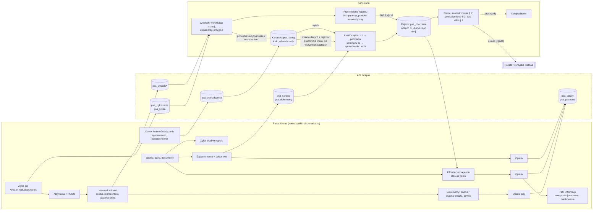

# Mapa procesów — stan z kodu (SESJA-PSA-ANALIZA-PRZEPLYWOW)

> **Odświeżona 7.11.2026** — stan po wdrożeniu etapów 1–5 analizy (`RAPORT-PRZEPLYWY.md` § 9) i decyzjach D-095–D-111.
> Pierwotna wersja (3.11.2026, po scaleniu R4 `8a75c01`) — w historii git; § 4 i § 5 pokazują, co się od niej zmieniło. Źródło: trasy `server/trasy/*.js`, widoki
> `publiczne/js/*.js`, katalog typów `server/logika/typy-zdarzen.js`. Pola wyliczone ekstraktorem
> (`<Pole etykieta=…>` w każdym komponencie) i sprawdzone ręcznie tam, gdzie heurystyka myli kontrolkę.
> Metryki z przeglądarki (kliknięcia, czasy, pola widoczne) są w `RAPORT-PRZEPLYWY.md` § 1 i w `testy/e2e/raport/wyniki.json`.

**Legenda źródła pola:** `reczne` — wpisuje człowiek; `kartoteka` — wybór osoby z kartoteki (`WyborZKartoteki`);
`rejestr` — wybór ze stanu rejestru (seria, akcjonariusz z akcjami, obciążenie); `auto` — wylicza system;
`domyslne` — system podstawia wartość, człowiek może zmienić.
**Podstawa:** przepis z `PRZEPISY-PSA.md` albo „operacyjna” albo **„brak”** (= kandydat do usunięcia, reguła 1).

---

## 1. Spis procesów

### Portal klienta (`publiczne/js/portal.js`, `wniosek.js`, `portal-start.js`; API `/api/psa/portal/*`)

| # | Proces | Ekrany / kroki | Endpointy | Tabele zapisywane | Zdarzenie w łańcuchu | Dokumenty | Powiadomienia | Opłata |
|---|---|---|---|---|---|---|---|---|
| P1 | Zgłoszenie nowej spółki („Zgłoś spółkę”, A-026) | `#/zglos-sie` — 1 ekran (e-mail, KRS, nazwa) | `POST /portal/zgloszenia` | `psa_zgloszenia`, `psa_konta` (zaproszenie automatyczne, D-038) | — | — | e-mail z linkiem aktywacyjnym | — |
| P2 | Zaproszenie → aktywacja konta | `#/aktywuj/:token` (hasło ×2) → klauzula RODO | `GET/POST /portal/aktywacja/:token`, `POST /portal/rodo` | `psa_konta` | — | — | — | — |
| P3 | Wniosek o prowadzenie rejestru | `#/wniosek` — kreator 4 kroków: Spółka (`PolaDanychSpolki`, A-002) → Reprezentant → Akcjonariusze (e-mail tylko przy zgodzie, D-099) → Podsumowanie | `PUT /portal/wniosek`, `GET /wniosek/z-krs/:numer`, `POST/PUT/DELETE /wniosek/akcjonariusze`, `POST /wniosek/zloz` | `psa_wnioski`, `psa_wnioski_akcjonariusze` | — | — | e-mail do kancelarii (licznik) | — |
| P4 | Podpis kompletu i dowód (umowa z danych wniosku — imiona rodziców i dowód reprezentanta tylko tu, D-108) | Start (baner kroku) → „Dokumenty”: pobranie, podpis (kwalifikowany / zaufany / osobisty / oryginał pocztą), skan dowodu reprezentanta | `GET /wniosek/dokumenty`, `POST /wniosek/dokumenty/:id/podpis`, `/oryginal-poczta`, `POST /wniosek/dowod`, `POST /wniosek/odeslij` | `psa_wnioski_dokumenty`, `psa_wnioski` | — | umowa o prowadzenie rejestru, uchwała, RODO, PEP (z `pakiet-wniosku.js`) | — | — |
| P5 | Opłata | Start / „Do zapłaty” → „Płatności” → atrapa tpay | `GET /portal/oplaty`, `POST /portal/oplaty/:id/zaplac`, ITN `POST /platnosci/tpay/itn` | `psa_oplaty`, `psa_platnosci` | — | faktura (poza systemem) | — | tak |
| P6 | Zgłoszenie przeniesienia rejestru od innego podmiotu | `#/zglos-sie` z „Kto dotąd prowadzi rejestr” ≠ „nikt” (warianty: dom maklerski / bank, notariusz, rada izby) → dalej jak P2–P4 + „Przeniesienie”: dokumenty startowe, pisma | `POST /portal/zgloszenia`, `GET /portal/przeniesienie`, `POST /portal/przeniesienie/dokumenty`, `GET /portal/przeniesienie/pisma/:kod` | `psa_zgloszenia`, `psa_przeniesienia` (przy przyjęciu wniosku), `psa_przeniesienia_dokumenty` | `przejecie` (dopiero K3) | wzór uchwały, klauzula, wypowiedzenie, potwierdzenie zawarcia, wezwanie do przekazania | — | — |
| P7 | Start / „Do zapłaty” | `#/` — karty: kroki wniosku, do zapłaty (ukryta, gdy pusta), spółki | `GET /portal/moje`, `GET /portal/oplaty`, `GET /portal/wnioski` | — | — | — | — | — |
| P8 | Zamówienie informacji z rejestru | „Spółka” → „Zamów informację z rejestru” → `#/informacja/:id` (Stan na dzień) → opłata → wydanie | `POST /portal/informacja/zamow`, `POST /portal/informacja/:oplataId/wydaj`, `GET /portal/informacja/:id` | `psa_oplaty`, `psa_wydane_dokumenty` | — | informacja z rejestru (art. 300(35) § 3; wersja akcjonariusza z maskowaniem) | — | tak |
| P9 | „Zgłoś błąd we wpisie” | „Spółka” → `#/zgloszenie-bledu/:id` (Czego dotyczy, opis) | `POST /portal/zgloszenie-nieprawidlowosci` | `psa_zgloszenia_nieprawidlowosci` | — | — | licznik w kancelarii | — |
| P10 | „Moje oświadczenia” | `#/konto` — 2 checkboxy (zgoda e-mail, powiadomienia automatyczne) + adres z kartoteki; cofnięcie z oknem „Cofnąć zgodę na e-mail?” | `GET/POST /portal/oswiadczenia` | `psa_oswiadczenia`, `psa_osoby` (D-092: kartoteka, nie rejestr) | — (D-092) | — | — | — |
| P11 | Żądanie wpisu z portalu („Zgłoś zmianę”, A-027) | `#/zgloszenie/:id` (Czego dotyczy, dokument, uwagi) → opłata → sprawa w kancelarii | `POST /portal/zadania`, `POST /portal/zadania/:id/dokumenty` | `psa_sprawy` (stan `nowa`, `zrodlo=portal`), `psa_dokumenty`, `psa_oplaty` | dopiero przy wpisie (K4) | — | — | tak (skuteczne z chwilą zapłaty) |
| P12 | Próba nowej spółki w tym samym logowaniu | „Wnioski” → nowy wniosek | `POST /portal/wniosek/nowy` → **403** (R4 P6) | — | — | — | — | — |

### Kancelaria (`publiczne/js/*.js`; API `/api/psa/*`)

| # | Proces | Ekrany / kroki | Endpointy | Tabele | Zdarzenie w łańcuchu | Dokumenty | Powiadomienia | Opłata |
|---|---|---|---|---|---|---|---|---|
| K1 | Zgłoszenia wstępne | `#/zgloszenia` → odrzuć / zaproś | `POST /zgloszenia/:id/zapros`, `/odrzuc` | `psa_zgloszenia`, `psa_konta` | — | — | e-mail z zaproszeniem | — |
| K2 | Obsługa wniosku z portalu | `#/wnioski/:id` — 4 zakładki: Dane spółki → Akcjonariusze (weryfikuj / do poprawy) → Dokumenty (wystaw, udostępnij, potwierdź podpis, podpis notariusza) → Decyzja (przyjmij / do uzupełnienia / odrzuć) | `/wnioski/:id/*` (20 tras) | `psa_wnioski*`, przy przyjęciu: `psa_spolki`, `psa_osoby` (akcjonariusze i reprezentant — D-101), `psa_konta`, `psa_spolki_dokumenty`, `psa_przeniesienia` | — | komplet wniosku | e-mail do klienta | — |
| K3a | Otwarcie rejestru — nowa spółka (kancelaria) | `#/spolki/nowa` — 4 kroki: Spółka → Umowa o prowadzenie rejestru (reprezentant z kartoteki, D-101) → Pierwsza emisja i akcjonariat → Weryfikacja. **D-111: każda spółka przechodzi przez przyjęty wniosek** — w praktyce K3b | `GET /spolki/z-krs/:numer`, `POST /spolki`, `POST /spolki/:id/otworz-rejestr` | `psa_spolki`, `psa_osoby`, `psa_emisje`, `psa_stan_akcji`, `psa_zdarzenia` | `emisja` + `objecie` (początek łańcucha) | zawiadomienie o wpisie | — | tak (wpis) |
| K3b | Otwarcie rejestru — spółka z przyjętego wniosku | kokpit → `#/spolki/:id/otworz` (ten sam kreator od kroku akcjonariatu, Z-005) | jw. | jw. | jw. | jw. | — | jw. |
| K3c | Przejęcie rejestru od innego podmiotu | `#/przeniesienia/:id` — status + przejścia, bieżący etap rozwinięty, pozostałe zwinięte (A-030), Dokumenty; „Otwórz rejestr” prowadzi wprost do kreatora stanu otwarcia (B-004, A-024) | `/przeniesienia/:id/*` (11 tras) | `psa_przeniesienia*`, `psa_spolki`, `psa_sprawy` | `przejecie` | protokół przejęcia — automatycznie przy otwarciu, skrót w PRZEJĘCIU (D-095); pisma Etapu 4 | — | do decyzji (wytyczne 7.2 Etap 9) |
| K4 | **Wpis — jeden kreator wpisu** (D-097; 18 typów, w tym zbycie) | kokpit (przycisk z `?typ=`) albo `#/spolki/:id/zdarzenie` (kafelki) → „Co się zmienia” → „Podstawa” → sprawa w tle → `#/sprawy/:id`: „Sprawdzenie i wpis” → „Dokonaj wpisu” → „{czynność} — wpis dokonany” | `POST /sprawy`, `PATCH /sprawy/:id {akcja: weryfikuj}`, `POST /sprawy/:id/podglad`, `POST /sprawy/:id/wpisz` | `psa_sprawy`, `psa_dokumenty`, `psa_zdarzenia`, tabele stanu | zdarzenie typu | zawiadomienie o wpisie (`zawiadomienie_wpis`), lista do KRS (§ 8) | uprzednie (§ 3) dla typów `pow`, o dokonanym wpisie (§ 7) | wg typu |
| K5 | **Wpis — zbycie akcji** (D-091, D-100) | ten sam kreator co K4 (wkład typu `WPIS_ZBYCIA`): „Co się zbywa” → „Podstawa” → „Sprawdzenie i wpis” | `POST /sprawy`, `PATCH`, `POST /sprawy/:id/powiadomienie`, `/zgoda`, `/wpisz` | jw. + `psa_listy` | `przeniesienie` | zawiadomienie, list z powiadomieniem | uprzednie (domyślnie, D-090) | tak |
| K6 | Sprawa z portalu (P11) | `#/sprawy/:id` — weryfikacja zaczyna się przy otwarciu (D-098), kreator K4 od kroku „Co” (podstawa w kroku 2, rodzaj dokumentu z typu — A-006); „Zmień rodzaj wpisu” (okno, tylko sprawy z portalu) | `PATCH /sprawy/:id {weryfikuj}`, `{podstawa}`, `{zmien-typ}` | `psa_sprawy` | jw. | jw. | jw. | opłacona w portalu |
| K7 | Wstrzymanie / odmowa / anulowanie sprawy | `PasekAkcji` sprawy → okna z powodem | `PATCH /sprawy/:id {wstrzymaj|wznow|odmow|anuluj}` | `psa_sprawy` | — | pismo o odmowie (§ 7 zd. 2) | żądający | — |
| K8 | Sprostowanie zdarzenia | kokpit → historia → okno „Sprostuj” (`ModalSprostowania`); okno „Sprostowanie emisji”. Typ poza kafelkami kreatora (D-103) | `POST /zdarzenia/:id/sprostuj` | `psa_zdarzenia` | `sprostowanie` | zawiadomienie | § 3 | — |
| K9 | Przekazanie rejestru innemu podmiotowi | kokpit → okno `ModalPrzekazania` | `POST /spolki/:id/przekazanie` | `psa_spolki`, `psa_przeniesienia_archiwum` | `przekazanie_rejestru` | eksport ZIP | — | — |
| K10 | Zmiana danych spółki | kokpit → „Dane rejestrowe” | `PUT /spolki/:id` | `psa_spolki`, `psa_zdarzenia` | `zmiana_danych_spolki` | — | — | — |
| K11 | Powiadomienia, zawiadomienia, kolejka listów | sprawa → „Uprzednie powiadomienie”; `#/zawiadomienia`; `#/listy` (nadanie: data, numer, skan; „Usuń z wysyłki”) | `/zawiadomienia/wyslij`, `/listy/:id/nadanie`, `/listy/:id/usun-z-wysylki` | `psa_listy`, `psa_wydane_dokumenty`, `psa_sprawy` (blokada wpisu) | — | pisma | e-mail albo list | — |
| K12 | Informacja z rejestru (kancelaria, dla organu) | kokpit → „Informacja z rejestru” (`#/spolki/:id/wydruk`); `#/informacje` (dziennik, dla organu: Spółka, Organ, Sygnatura) | `GET /spolki/:id/informacja.html`, `POST /informacje/organ` | `psa_wydane_dokumenty` | — | informacja (art. 300(35) § 3) | — | — |
| K13 | Kartoteka — nowa osoba, edycja, AML | `#/osoby` → okno `FormularzOsoby`; `#/osoby/:id` (identyfikacja, adresy, kontakt i oświadczenia, AML, akcje, sprawy); w kreatorach „+ Nowa osoba w kartotece”, w zbyciu „Nowy nabywca” — ten sam `PanelOsoby` (A-019). Dane z rejestru (art. 300(33) § 1 pkt 5) osoby z akcjami kartoteka nie nadpisuje — proponuje wpis „Zmiana danych akcjonariusza”, łącznie we wszystkich jej spółkach (D-102, D-107) | `POST /osoby`, `PUT /osoby/:id`, `POST /osoby/:id/aml-skany`, `/zapros-do-portalu` | `psa_osoby`, `psa_oswiadczenia`, `psa_osoby_skany_aml` | — (D-092) | — | zaproszenie do portalu | — |
| K14 | Opłaty | `#/oplaty` — lista, okno „Nowa opłata”, faktura, przypomnienia, odnowienia | `/oplaty/*` (9 tras) | `psa_oplaty` | — | — | przypomnienie e-mail | — |
| K15 | Zgłoszenia błędów z portalu | kokpit → okno „Kwalifikacja zgłoszenia” | `POST /zgloszenia-nieprawidlowosci/:id/kwalifikuj` | `psa_zgloszenia_nieprawidlowosci` | — | — | — | — |

---

## 2. Typy wpisu w kodzie (wyliczone z `TYPY`, nie z pamięci)

22 typy; 18 w kreatorze wpisu (`dostepneWKreatorze()`), 4 poza nim: `zmiana_danych_spolki` K10, `przekazanie_rejestru` K9,
`przejecie` K3c, `sprostowanie` K8 (D-103).
Portal oferuje typy ze sprintów 1–2 bez `z_urzedu` (`portal.js:1929`).

| Typ (kod) | Nazwa | W kreatorze | Odpł. | Powiad. art. 300(34) § 3 | Z urzędu | Checklista (wym./opc.) | Dokumenty | Podstawa (z kodu) |
|---|---|---|---|---|---|---|---|---|
| `emisja` | Emisja akcji | tak | tak | — | — | 3/1 | zawiadomienie_wpis | art. 300(33) § 1 KSH |
| `objecie` | Objęcie akcji | tak | tak | — | — | 4/2 | zawiadomienie_wpis | art. 300(33) § 1 KSH |
| `przeniesienie` | Przeniesienie akcji | tak (K5) | tak | tak | — | 5/1 | zawiadomienie_wpis | art. 300(34) § 3 KSH |
| `umorzenie` | Umorzenie akcji | tak | tak | tak | — | 4/2 | zawiadomienie_wpis | art. 300(34) § 3 KSH |
| `zobowiazanie` | Zobowiązanie do przeniesienia lub obciążenia akcji | tak | tak | tak | — | 2/1 | zawiadomienie_wpis | art. 300(34) § 4 KSH |
| `obciazenie` | Ustanowienie zastawu lub użytkowania | tak | tak | tak | — | 2/1 | zawiadomienie_wpis | art. 300(34) § 3 KSH |
| `wykreslenie_obciazenia` | Wykreślenie obciążenia | tak | tak | — | — | 2/1 | zawiadomienie_wpis | art. 300(33) § 1 KSH |
| `prawo_glosu_zastawnika` | Prawo głosu zastawnika lub użytkownika | tak | tak | tak | — | 2/1 | zawiadomienie_wpis | art. 300(33) § 1 KSH |
| `zajecie` | Zajęcie akcji przez organ egzekucyjny | tak | — | — | tak | 2/0 | — | art. 300(34) § 2 KSH |
| `wykreslenie_zajecia` | Uchylenie zajęcia | tak | — | — | tak | 1/0 | — | art. 300(34) § 2 KSH |
| `zmiana_danych_akcjonariusza` | Zmiana danych akcjonariusza (łącznie we wszystkich spółkach osoby — D-107) | tak | — | — | — | 1/0 | zawiadomienie_wpis | art. 300(33) § 1 KSH |
| `zmiana_danych_spolki` | Zmiana danych spółki | nie (K10) | — | — | — | 1/0 | — | art. 300(33) § 1 KSH |
| `przekazanie_rejestru` | Przekazanie rejestru | nie (K9) | — | — | — | 0/0 | — | art. 300(33) § 1 KSH |
| `przejecie` | Przejęcie rejestru (otwarcie) | nie (K3c) | — | — | — | 0/0 | — | art. 300(31) § 1 KSH |
| `uprawnienie` | Uprawnienie, przywilej albo obowiązek | tak | — | — | — | 2/1 | zawiadomienie_wpis | art. 300(33) § 1 KSH |
| `ograniczenie` | Ograniczenie w rozporządzaniu akcją | tak | tak | — | — | 2/1 | zawiadomienie_wpis | art. 300(34) § 6 KSH |
| `zdarzenie_inne` | Inne zdarzenie | tak | — | — | — | 1/0 | — | art. 300(33) § 1 KSH |
| `sprostowanie` | Sprostowanie wcześniejszego zdarzenia | nie (K8, D-103) | — | tak | — | 1/0 | zawiadomienie_wpis | art. 300(34) § 1 KSH |
| `uniewaznienie` | Unieważnienie akcji orzeczeniem sądu | tak | tak | — | — | 4/1 | zawiadomienie_wpis | art. 300(51) KSH |
| `przeniesienie_ulamka` | Przeniesienie ułamkowej części akcji | tak | tak | tak | — | 4/2 | zawiadomienie_wpis | art. 300(2) § 3 oraz art. 300(43) KSH |
| `przedstawiciel` | Wspólny przedstawiciel współuprawnionych | tak | — | — | — | 1/0 | zawiadomienie_wpis | art. 300(38) § 3-4 KSH |
| `pokrycie_akcji` | Wzmianka o pokryciu akcji | tak | — | — | — | 1/0 | zawiadomienie_wpis | art. 300(33) § 1 pkt 9 KSH |

### 2.1 Kroki wpisu (K4/K5 — jeden kreator, D-097)

| Krok | Ekran | Pole | Źródło | Wym. | Podstawa |
|---|---|---|---|---|---|
| — | `#/spolki/:id/zdarzenie` | Rodzaj wpisu (kafelki, 7 grup) | reczne (albo z adresu `?typ=`) | tak | art. 300(33) § 1 |
| 1 „Co się zmienia” („Co się zbywa”) | `#/spolki/:id/zdarzenie?typ=…` | pola typu — § 2.2 (numery akcji z doboru, ręcznie za przyciskiem — D-105) | | | |
| 2 „Podstawa” | jw. | Data dokumentu (zbycie: „Data umowy zbycia”) | reczne | tak (poza z urzędu) | art. 300(34) § 4 |
| 2 | jw. | Dokument (plik) — dziedziczy rodzaj dokumentu | reczne | nie | art. 300(34) § 4 |
| 2 | jw. | W jakim charakterze | domyslne z typu (A-013) | tak (poza z urzędu) | art. 300(34) § 1 |
| 2 | jw. | Żądający wpisu | domyslne: spółka z rejestru spółek (D-096) albo osoba z kroku 1 (`osobaWCharakterze`); inaczej kartoteka | tak (poza z urzędu) | art. 300(34) § 1 |
| 2 | jw. | Interes prawny żądającego | reczne | gdy „inna osoba” | art. 300(34) § 1 |
| 2 | jw. | Rodzaj dokumentu, Data wpływu, Notatka — za jednym przyciskiem | domyslne z typu (A-005) / auto (dziś) / reczne | — | art. 300(34) § 1, § 4 / operacyjna |
| 2 | jw. | Tytuł przejścia akcji (tylko zbycie) | domyslne „sprzedaż” | tak | art. 300(33) § 1 pkt 6 |
| — | **„Dalej”** → sprawa w tle: `POST /sprawy`, `PATCH weryfikuj`, podgląd ze szkicem → `#/sprawy/:id` | | | | |
| 3 „Sprawdzenie i wpis” | `#/sprawy/:id` | podgląd automatyczny; pola warunkowe typu (zbycie: zgoda spółki, art. 300(40), pierwszeństwo); uprzednie powiadomienie z domyślnym adresatem (D-104) albo zgoda; checklista; „Mam wątpliwości — wstrzymaj wpis” | auto / domyslne / reczne | wg typu | art. 300(34) § 3, § 5 |
| 3 | jw. | Osoba działająca | auto; wybór tylko, gdy niejednoznaczna | — | operacyjna |
| — | **„Dokonaj wpisu”** → „{czynność} — wpis dokonany” (emisja → „Wpisz, kto objął akcje” z tą samą podstawą) | | | | |

### 2.2 Pola kroku „Co się zmienia” wg typu (ekstraktor `<Pole>` w `kreator.js`)

| Typ | Pola (źródło, * = wymagane) |
|---|---|
| `emisja` | Oznaczenie serii* (reczne); Liczba akcji* (reczne); Numer pierwszej akcji (auto, nadpisywalne); Cena emisyjna (reczne); Rodzaj akcji (domyslne „zwykła”); Data wpisu emisji do KRS* (reczne); Data emisji (reczne); Tytuł emisji (domyslne „Emisja założycielska”); Podstawa prawna emisji (reczne); Obowiązki wobec spółki (reczne); Opis (reczne) — **11 pól** |
| `objecie` | na pozycję: Obejmujący* (kartoteka); Liczba akcji* (reczne); Numery akcji — ścieżka wyjątkowa (auto); Seria* (rejestr) |
| `umorzenie` | Tryb umorzenia (reczne); Akcjonariusz* (rejestr, `<select>`); Liczba akcji*; Numery akcji (za przyciskiem, D-105) |
| `uniewaznienie` | Sąd; Sygnatura akt; Data orzeczenia; Akcjonariusz* (rejestr, `<select>`); Liczba akcji* |
| `obciazenie` | Rodzaj obciążenia; Akcjonariusz, którego akcje są obciążane* (**kartoteka** — nie rejestr); Zastawnik / użytkownik* (kartoteka); Liczba akcji*; Numery akcji; Opis |
| `wykreslenie_obciazenia` | Obciążenie* (rejestr) |
| `prawo_glosu_zastawnika` | Obciążenie* (rejestr); Prawo głosu (reczne) |
| `zajecie` | Organ egzekucyjny (kartoteka); Akcjonariusz (dłużnik) (kartoteka); Liczba akcji objętych zajęciem* lub Numery zajmowanych akcji*; Opis |
| `wykreslenie_zajecia` | Zajęcie* (rejestr) |
| `uprawnienie` | (wykreślenie) Wykreślane uprawnienie*; (ustanowienie) Rodzaj; Zakres; Akcjonariusz* (kartoteka); Tytuł; Treść |
| `ograniczenie` | (wykreślenie) Wykreślane ograniczenie*; Zakres; Numery akcji*; Opis |
| `zmiana_danych_akcjonariusza` | Akcjonariusz* (rejestr); nowe dane — formularz kartoteki (`PanelOsoby`), tabela „dziś w rejestrze → po wpisie” (D-102) |
| `zobowiazanie` | Akcjonariusz składający oświadczenie* (kartoteka); Rodzaj zobowiązania; Seria (opcjonalnie, rejestr); Treść oświadczenia |
| `zdarzenie_inne` | Opis zdarzenia* |
| `przeniesienie_ulamka` | Zbywca* (rejestr); Numer akcji*; Ułamek zbywanej części*; Tytuł przejścia (domyslne); Nabywca* (kartoteka) |
| `przedstawiciel` | Numer akcji*; Wspólny przedstawiciel (kartoteka) |
| `pokrycie_akcji` | Akcjonariusz* (kartoteka); Wzmianka o pokryciu* (reczne) |
| `sprostowanie` | poza kreatorem (K8): prostowane zdarzenie (rejestr); uzasadnienie (reczne) |

### 2.3 K5 — zbycie: wkład typu w kreator wpisu (`definicjaWpisu.przeniesienie`, `WPIS_ZBYCIA`)

| Krok | Pole | Źródło | Wym. | Widoczne gdy | Podstawa |
|---|---|---|---|---|---|
| 1 Co się zbywa | Zbywca | rejestr | tak | zawsze | art. 300(33) § 1 pkt 6 |
| 1 | Liczba zbywanych akcji | reczne | tak | zawsze | art. 300(33) § 1 pkt 6 |
| 1 | Seria / Numery akcji | auto (dobór), ręcznie za przyciskiem | — | zawsze (podgląd) | art. 300(33) § 1 pkt 6 |
| 1 | Nabywca | kartoteka (+ „Nowy nabywca” → `PanelOsoby`, A-019) | tak | zawsze | art. 300(33) § 1 pkt 6 |
| 2 Podstawa | Data umowy zbycia | reczne | tak | zawsze | art. 300(34) § 4 |
| 2 | Umowa (plik) | reczne | nie | zawsze | art. 300(34) § 4 |
| 2 | W jakim charakterze / Żądający | domyslne (nabywca, osoba z kroku 1); spółka bez kartoteki (D-096) | tak | zawsze | art. 300(34) § 1 |
| 2 | Tytuł przejścia akcji | domyslne (sprzedaż) | tak | zawsze | art. 300(33) § 1 pkt 6 |
| 2 | Data wpływu, rodzaj dokumentu | auto / domyslne (umowa zbycia), zmiana za przyciskiem | tak | za przyciskiem | art. 300(34) § 1, § 4 |
| 3 Sprawdzenie i wpis | Zgoda spółki | reczne | — | ograniczenie z wymogiem zgody | art. 300(34) § 6 |
| 3 | Zgoda spółki (akcje niepokryte) | reczne | — | dobór zawiera niepokryte | art. 300(40) § 1 |
| 3 | Prawo pierwszeństwa wyczerpane | reczne | — | ograniczenie z prawem pierwszeństwa | art. 300(42) |
| 3 | Uprzednie powiadomienie (domyślne) albo zgoda (jedno pole) | domyslne | — | zawsze | art. 300(34) § 3 |
| 3 | Checklista weryfikacji (6) | reczne (człowiek) | wym. | zawsze | art. 300(34) § 5 (D-052) |
| 3 | Osoba działająca | auto (domyślna pracownika albo jedyny notariusz) | — | gdy niejednoznaczna | operacyjna |

---

## 3. Pozostałe procesy — pola

| Proces | Krok / ekran | Pole | Źródło | Wym. | Podstawa |
|---|---|---|---|---|---|
| P1 | `#/zglos-sie` | E-mail | reczne | tak | operacyjna (konto, art. 300(34) § 9) |
| P1 | jw. | Numer KRS spółki | reczne (→ nazwa z KRS) | tak | art. 300(33) § 1 pkt 2 |
| P1 | jw. | Nazwa spółki | auto (KRS), nadpisywalne | nie | art. 300(33) § 1 pkt 1 |
| P1/P6 | jw. | Kto dotąd prowadzi rejestr | reczne (lista) | tak | wytyczne 7.2 Etap 1 |
| P6 | jw. | Nazwa dotychczasowego podmiotu | reczne | nie | wytyczne 7.2 Etap 1 |
| P6 | jw. | Okres wypowiedzenia (jeśli znany) | reczne | nie | wytyczne 7.2 Etap 1 — „informacyjnie”; zostaje (D-110) |
| P3 Spółka | `#/wniosek` 1/4 | KRS, Firma*, NIP, REGON, adres (5), sąd, wydział, organ, data rejestracji, kapitał, data umowy, e-mail, telefon, ADE | auto z KRS (`/wniosek/z-krs`) + reczne | wg pola | art. 300(33) § 1 pkt 1–3; NIP/REGON/telefon/kapitał — operacyjna |
| P3 Reprezentant | 2/4 | Imię i nazwisko, Funkcja, Sposób reprezentacji, PESEL, Imiona rodziców, e-mail, dowód (rodzaj, numer), adres, skan dowodu | reczne | wg pola | AML (art. 37 u. AML — 🔵) / operacyjna. Przy przyjęciu — osoba w kartotece (D-101); imiona rodziców i dowód tylko do umowy, nie przechodzą do spółki (D-108) |
| P3 Akcjonariusze | 3/4 | `FormularzOsoby` na osobę (+ liczba akcji, seria) | reczne | tak | art. 300(33) § 1 pkt 4–5 |
| K3a Spółka | `#/spolki/nowa` 1/4 | KRS, odpowiedź KRS, skład organu + `PolaDanychSpolki` — **ten sam komponent co P3 1/4** (A-002) | auto z KRS + reczne | wg pola | jw. |
| K3a Umowa | 2/4 | Data uchwały o wyborze; Data umowy o prowadzenie rejestru; Data otwarcia rejestru; Sposób zawarcia umowy*; Skan umowy; Reprezentant (kartoteka, D-101); Funkcja | reczne | wg pola | art. 300(31) § 5, art. 300(32) |
| K3a Emisja | 3/4 | `KrokEmisja` (11 pól) + `PozycjaZalozycielska` na akcjonariusza (Obejmujący*, Liczba*, Wzmianka o pokryciu, Cena, Rodzaj świadczenia, Czas świadczenia, Uprawnienia szczególne) | reczne / kartoteka | wg pola | art. 300(33) § 1 pkt 3–4, 9, 11 |
| K3c Przejęcie | `#/przeniesienia/:id` | Data zawarcia umowy, Data rozwiązania (`PoleDaty`, A-016); Opis rozbieżności; checklista weryfikacji (5); dokumenty (typ z 8 + źródło + plik); checklista odbioru (6); protokół — automatycznie (D-095), podgląd PDF | reczne | wg etapu | wytyczne § 7 |
| K11 nadanie | `#/listy` | Data nadania (`PoleDaty`); Numer nadania*; Skan potwierdzenia | reczne | tak | art. 300(34) § 3 (dowód powiadomienia) |
| P8 | `#/informacja/:id` | Stan na dzień | domyslne (dziś), `PoleDaty` | tak | art. 300(35) § 3 |
| P9 | `#/zgloszenie-bledu/:id` | Czego dotyczy*; Opis* | reczne | tak | operacyjna |
| P11 | `#/zgloszenie/:id` | Czego dotyczy*; Dokument (plik); Uwagi | reczne | tak / nie / nie | art. 300(34) § 1, § 4 |
| K12 wzór 01 | kokpit → dokumenty na żądanie → umowa | Imiona rodziców reprezentanta; Dokument tożsamości reprezentanta | reczne, bez zapisu (D-108) | nie | umowa o prowadzenie rejestru |
| K14 | okno „Nowa opłata” | Spółka*, Rodzaj*, Rok*, Kwota, Notatka | reczne | wg pola | operacyjna (§ 15b taksy) |

---

## 4. Rozbieżne wzorce (ta sama czynność — różne komponenty) — stan po etapie 4

| # | Czynność | Stan 3.11.2026 | Po etapie 4 |
|---|---|---|---|
| W1 | **Wybór akcjonariusza** | `WyborZKartoteki` (cała kartoteka) w `obciazenie`, `uprawnienie`, `zobowiazanie`, `pokrycie_akcji`, `zajecie` vs `<select>` z rejestru w `umorzenie`, `uniewaznienie`, zbycie, `przeniesienie_ulamka` | akcjonariusz zawsze z rejestru (`WyborAkcjonariusza`, A-015, etap 5); z kartoteki — zastawnik, organ, nabywca, obejmujący, przedstawiciel |
| W2 | **Nowa osoba w trakcie wpisu** | „+ Nowa osoba w kartotece” vs `NowyNabywca` w zbyciu | jeden `PanelOsoby` („Dodaj do kartoteki”, A-019) |
| W3 | **Pole daty** | `PoleDaty` vs natywne `type="date"` (4) | `PoleDaty` wszędzie (A-016, A-035: `min`/`max` także z klawiatury) |
| W4 | **Okno potwierdzenia** | `Modal` vs `window.confirm` (9) vs `alert` (5) | okno aplikacji `potwierdz()` z nazwą czynności wszędzie (także blokada wyjścia); błędy na ekranie zamiast `alert` (A-017, etap 5) |
| W5 | **Pasek akcji** | `PasekAkcji` tylko w sprawie i zbyciu | `PasekAkcji` w kreatorze wpisu, wniosku (tryb dużych przycisków zamiast `NawigacjaKreatora`) i przeniesieniu (A-021); kokpit — przyciski nagłówka |
| W6 | **Kreator wpisu** | 4 kroki na dwóch adresach (K4) vs 3 kroki (K5) | jeden kreator 3 kroków (D-097); po „Podstawie” zmiana adresu na `#/sprawy/:id` (jak dawniej w zbyciu) |
| W7 | **Nazwa kroku weryfikacji** | „Weryfikacja i podgląd” / „Sprawdzenie i wpis” / „Weryfikacja” | „Sprawdzenie i wpis” w każdym wpisie; „Weryfikacja” zostaje w otwarciu rejestru (K3a) |
| W8 | **Podstawa wpisu** | krok 2 K4 vs okno `PodstawaWpisu` vs krok 2 zbycia | krok 2 kreatora wszędzie; okno tylko do zmiany rodzaju wpisu (A-006) |
| W9 | **Sprostowanie** | typ w kreatorze + 2 okna | 2 okna (historia, sprostowanie emisji); typ poza kreatorem (D-103) |
| W10 | **Dane spółki** | dwa formularze (P3 1/4, K3a 1/4) | `PolaDanychSpolki` (A-002) |
| W11 | **Lista danych** | `ListaDanych` vs `Metryka` vs `Para` vs tabele ad hoc | `Para` usunięty (A-022); `Metryka` zostaje (pasek wskaźników — inna rola) |
| W12 | **Znacznik kontaktu** | brak przy akcjonariuszach w kokpicie i we wniosku | kokpit (tabela akcjonariatu) i wniosek — portal i kancelaria (etap 5) |

---

## 5. Przeniesienie rejestru — „protokół”

**Po D-095 (wdrożone w etapie 3):** protokół (dokumenty ze skrótami SHA-256 + odhaczona checklista odbioru) powstaje przy
„Otwórz rejestr” i jego skrót trafia do zdarzenia PRZEJĘCIE (`server/trasy/spolki.js`, `server/przeniesienia.js`); zatwierdzeniem
notariusza jest samo otwarcie rejestru. Karta „Etap 7” ma tylko podgląd PDF — bez pobierania, podpisu poza systemem i wgrywania.
Kolumny `protokol_*` / `zatwierdzenie_*` zostają w bazie (dawne przeniesienia).

**Stan z 3.11.2026 (przed D-095):** PDF do pobrania → podpis kwalifikowany poza systemem → wgranie (`POST /:id/zatwierdzenie`,
test podpisu D-086) → dopiero wtedy przejście „Uzgodnienie → Aktywny”.

**Podstawa:** w `PRZEPISY-PSA.md` brak przepisu o protokole odbioru/uzgodnienia. Wytyczne § 7.2 Etap 7
mówią o „zatwierdzeniu przez notariusza (QES)” zdarzenia otwierającego PRZEJĘCIE; dokumentem wymaganym
ustawowo jest **uchwała akcjonariuszy o wyborze podmiotu** (art. 300(31) § 5) — dziś jeden z 8 typów
dokumentu w liście, wymagany przez checklistę Etapu 3.

**Ocena:** protokół nie ma podstawy ustawowej; jego treść (dokumenty + checklista odbioru) powstaje
w całości z danych już w systemie. Osobny krok „pobierz → podpisz poza systemem → wgraj → przejdź do
Aktywny” nie niesie nowej decyzji człowieka ponad odhaczenie checklisty Etapu 6 (reguła 5). Kierunek:
protokół generowany automatycznie przy zamknięciu checklisty odbioru i dołączany do zdarzenia PRZEJĘCIE
(skróty w łańcuchu, art. 300(31) § 4); zatwierdzenie notariusza = samo przejście do „Aktywny”
(przycisk), bez pliku. Rozstrzygnięcie → **D-095** w raporcie.

---

## 6. Diagram przepływu

**Granica portal/rejestr i dane osobowe przez nią przechodzące:**
portal → kancelaria: e-mail, KRS, dane spółki, dane reprezentanta (imię, nazwisko, PESEL, adres, skan dowodu;
imiona rodziców i dowód — tylko do umowy z wniosku, nie przechodzą do spółki — D-108), dane akcjonariuszy (imię, nazwisko/firma, PESEL/data urodzenia, adres, e-mail,
zgoda), oświadczenia, dokumenty z podpisami.
kancelaria → portal: stan rejestru (wersja spółki pełna; wersja akcjonariusza — bez PESEL, daty urodzenia
i adresów innych, art. 300(35) § 1(1)), informacja z rejestru, dokumenty spółki, opłaty, stan zgłoszeń.
Przy przyjęciu wniosku dane z `psa_wnioski_akcjonariusze` i reprezentant z `psa_wnioski` są **kopiowane** do `psa_osoby`
(jednorazowo; reprezentant — ta sama osoba po PESEL albo nowa, D-101). Dalej dane osób żyją tylko w kartotece; dane z rejestru
(art. 300(33) § 1 pkt 5) zmienia wyłącznie wpis (D-102, D-107).
